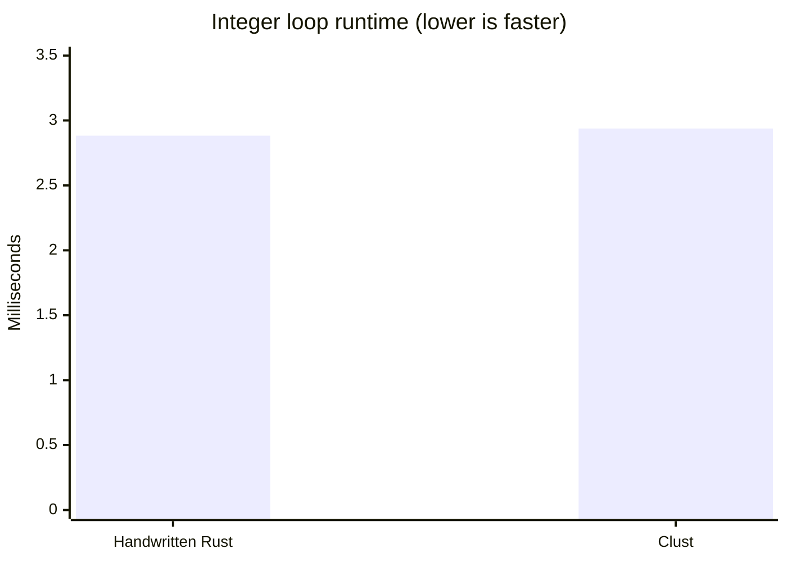

# Clust


Clust is an experimental language for writing native applications with classes, methods and automatic memory cleanup. You write Clust, the compiler generates Rust, and the Rust toolchain builds an executable for your machine. You can start with Clust syntax and inspect the generated Rust whenever you want to see how a program works.

## A counter you can run

```clust
class Counter {
    value: i32
    new(value: i32) {
        self.value = value;
    }
    pub read(self) -> i32 {
        return self.value;
    }
    pub add(var self, amount: i32) {
        self.value += amount;
    }
}

fn main() -> i32 {
    var counter = Counter.new(2);
    counter.add(3);
    return counter.read();
}
```

Read `i32` as a 32-bit integer and `self` as the current object. The difference between the two methods is visible at the call boundary. `read(self)` can inspect the counter. `add(var self, ...)` can change it. The compiler checks who may change a value and infers when a call can borrow it. When the counter's owner goes out of scope, cleanup happens automatically, without a garbage collector or a manual call to free memory.

From this checkout, install Clust with Cargo, the build tool included with Rust. Use Rust 1.88 or newer. The primary development target is Apple Silicon macOS.

```sh
cargo install --path cli --locked
clust eval examples/clust_counter/main.cl
```

The evaluator returns `5`. To build and execute the native version, use `clust run examples/clust_counter/main.cl`. The example communicates its result through process exit code `5`. Use `clust emit-rust examples/clust_counter/main.cl` to inspect the generated code. [CLI guide](docs/cli.md)

## What does native performance look like?

We ran the same integer loop in Clust and handwritten Rust. Each run performed two million updates. Both versions used the same Rust compiler (1.100.0), optimization level 3 and wrapping arithmetic on arm64 macOS. The benchmark alternates run order, checks that both results match and reports the median of nine runs. It times only the loop call.



The medians were **2.883 ms for Rust** and **2.938 ms for Clust**. This measures arithmetic throughput on one machine. Allocation-heavy programs exercise different parts of the compiler. [Vector allocation measurements](performance/vec-growth/README.md)

Reproduce the loop comparison from the repository root:

```sh
cargo test --locked -p clust-core --test performance -- --ignored --nocapture
```

## What works today?

Clust is a working prototype with a synchronous language MVP. You can use inheritance and interfaces, write generic functions, match on results, and store owned values in strings and vectors. A single-file async program can also launch tasks on Tokio (Rust's async runtime), send messages over channels and share state through actors or mutexes. [Classes](examples/clust_animals) · [Collections](examples/clust_iteration) · [Async example](examples/clust_async/main.cl)

Rust integration currently supports explicit declarations for functions with scalar inputs and outputs, such as integers. For example, this declaration lets Clust code call Rust's standard maximum function as `maximum(3, 7)`:

```clust
#[rust("std.cmp.max")]
extern "Rust" fn maximum(left: i32, right: i32) -> i32;
```

These calls compile into the native program. Cargo path dependencies are supported in manifest builds. [Runnable Rust example](examples/clust_rust/main.cl) · [Implementation status](docs/implementation-status.md)

## Where you can contribute

- **Make Rust libraries feel native.** A first milestone is calling a function from a neighboring Rust module by its dotted name, without writing an adapter. Later milestones cover owned Rust types, crates, derives and macros. [Rust integration plan](docs/rust-interop-plan.md)
- **Extend collection iteration.** Today's collection loop reads elements through `len` and `at`. Mutable iteration, ranges and general iterator traits are open language work. [Iteration example](examples/clust_iteration) · [Specification](SPEC.md)
- **Help the next reader learn Clust.** Run an example and describe the first line or diagnostic you had to look up. A small example, a clearer error message or a failing test for an unsupported case gives contributors a concrete starting point. [Examples](examples) · [Language guide](docs/README.md)

For compiler changes, the architecture guide maps syntax, type checking, ownership analysis and Rust generation to their modules. Run `cargo test --workspace --locked` to exercise the project and `cargo fmt --all -- --check` to check formatting. [Compiler architecture](docs/architecture.md)
